:PROPERTIES:
:ID:       report-outline
:END:
#+title: Report Outline
#+author: Luke Bailey
#+LATEX_HEADER: \usepackage{float}

Below is my report on the methods I applied during image analysis on a pool ball table where the pool balls appeared in a variety of different positions. My goals were twofold:

- Find the balls: I had to locate the position of each ball on the table and return their position as coordinates

- Identify the balls: After finding the balls, I then had to identify each ball as its assigned number (or the white ball).

The assignment brief made it clear to me how much I should focus on evaluation and the metrics I pick as one of the primary goals of this project right from the get go. As a result, before even writing a single line of code I started by first figuring out how I was going to evaluate this work.

The primary metrics I selected were all ones I recalled from prior lectures. I opted for:
- Precision (the fraction of detections that were real balls)
- Recall (the fraction of real balls that were found)
- F1 (the harmonic mean of precision and recall)
- Identification Accuracy (the fraction of correctly located balls that got identified with the right number)

I was also aware that my submitted application code would likely be evaluated against more permutations of the pool table than I had access to based on the small sample amount provided in the assignment. Hence, in order to increase the generality of my code, I also decided to write an external wrapper harness around what I would submit in order to test my code against further augmented versions of the original test set, doing things like mirroring the original images, applying extra noise, playing with saturation values, and more in order to try and make my code resilient to unexpected changes.

After all of this, I could then plan what algorithm I would actually implement in my vision processing system. I decided to plan a couple feasible variants since truthfully I wasn't too sure which would perform the best without measuring and evaluating them each in turn.

* TODO Theory of the processing done (roughly 50%).

Here, I will only describe the final algorithm I landed on.

** TODO You must describe the underlying theory of what you have done. You MUST not refer to code or library calls in the report.

#+CAPTION: The original photo, with the table outline used for the perspective correction.
#+ATTR_ORG: :width 600
#+ATTR_LATEX: :placement [H] :width 0.9\textwidth
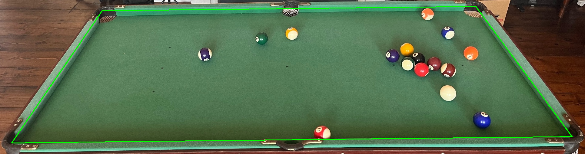

First of all, I noticed that the pool table appears at a slight angle from the camera and decided it would probably be in my best interests to do a perspective transform in order to get a more head on view. In this step I also crop part of the background just in case anything appears there that could interfere. To do this I used the table corners that were provided as the corner points.

#+CAPTION: The table after perspective correction.
#+ATTR_ORG: :width 600
#+ATTR_LATEX: :placement [H] :width 0.9\textwidth
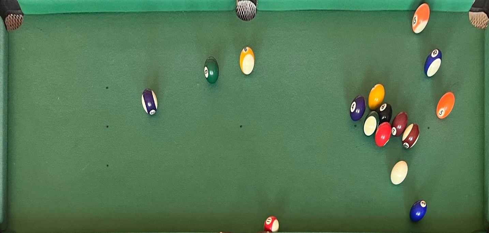

Next, since the table cloth is not one solid colour, but rather a textured object, I decided to denoise it a bit by applying a median blur to make it easier to separate the balls from the pool table cloth later on.

#+CAPTION: The table after median blurring.
#+ATTR_ORG: :width 600
#+ATTR_LATEX: :placement [H] :width 0.9\textwidth
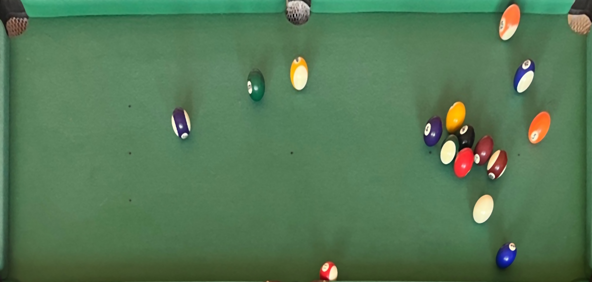

I then produce a hue and saturation histogram for the cloth from the reference photo, as the lighting across the table isn't uniform and sampling hue and saturation means I can easily model the cloth first without interference from things like that.

#+CAPTION: The cloth's hue and saturation histogram: hue runs down, saturation runs across, and brighter means more common.
#+ATTR_ORG: :width 300
#+ATTR_LATEX: :placement [H] :width 0.4\textwidth
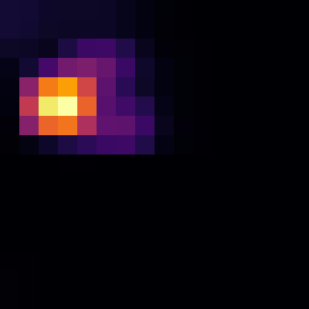

After that, I then segment the non cloth object by back-projecting that histogram, giving me a greyscale image where the cloth is bright and the balls are dark. Once I have that, I can then run Otsu thresholding in order to clearly separate those into a binary "not cloth" mask. Once I have that, I then do a morphological open in order to remove any small flecks/leftover artifacts of noise and ensure that what I end up with is actually mainly just balls.

#+CAPTION: Back-projection of the cloth histogram: the cloth is bright and the balls are dark.
#+ATTR_ORG: :width 600
#+ATTR_LATEX: :placement [H] :width 0.9\textwidth
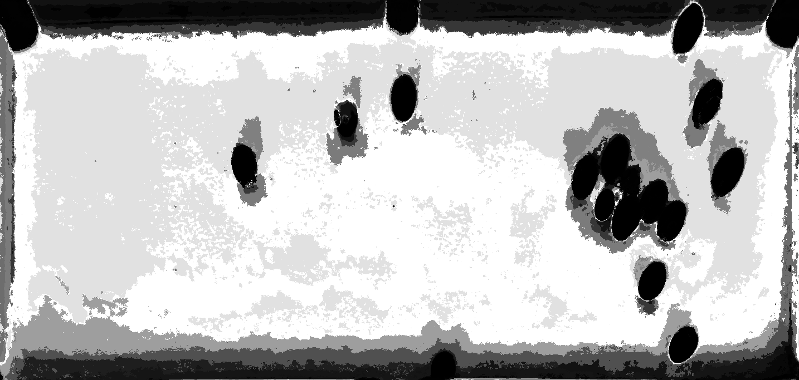

#+CAPTION: The "not cloth" mask after Otsu thresholding and the morphological open.
#+ATTR_ORG: :width 600
#+ATTR_LATEX: :placement [H] :width 0.9\textwidth
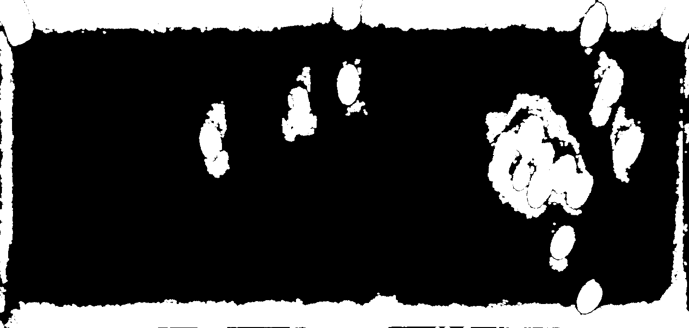

After that I converted this into a relative LAB image by subtracting the cloth's average colour, in order to accurately measure how different two colours (the cloth vs the balls) look, allowing me to meaningfully measure distance.

#+CAPTION: Colour distance from the cloth in LAB.
#+ATTR_ORG: :width 600
#+ATTR_LATEX: :placement [H] :width 0.9\textwidth
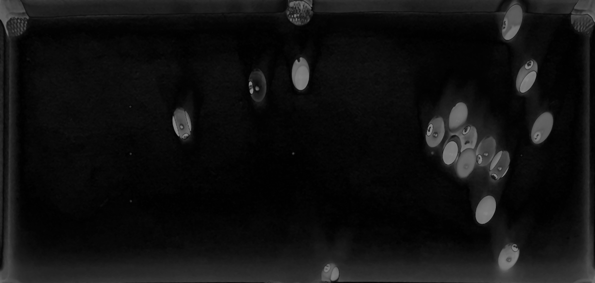

With that, I then went and detected the photo edges with Canny, since it produces a number of thin, well located edges where the balls are. Using that edge map, I then ran a Hough transform in order to get approximate circle centers and radii for each ball. This also handles touching balls for me too. Both of these are run on the original image with no perspective transform since the balls will not appear as circles otherwise. I ran Hough in strips rather than all in one go as balls closer to the camera look bigger.

#+CAPTION: Canny edges, in the original photo's perspective.
#+ATTR_ORG: :width 600
#+ATTR_LATEX: :placement [H] :width 0.9\textwidth
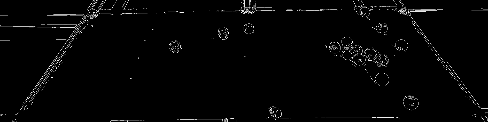

#+CAPTION: Candidate circles found by the Hough transform.
#+ATTR_ORG: :width 600
#+ATTR_LATEX: :placement [H] :width 0.9\textwidth
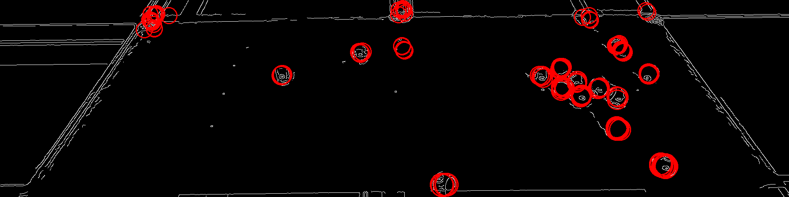

Once I have the data from Hough, I then attempt to reject circles that aren't the balls (i.e. the cushions where balls go to score) by seeing if it lies too close to the table edge. I then also reduce it to a ball sized footprint by masking it with a ball image taken from the reference in order to filter things like shadows or the rest of the cushions. Each remaining candidate is scored by how much of its outline lies on a detected edge.

#+CAPTION: The ball mask: the "not cloth" pixels with the cushion removed.
#+ATTR_ORG: :width 600
#+ATTR_LATEX: :placement [H] :width 0.9\textwidth
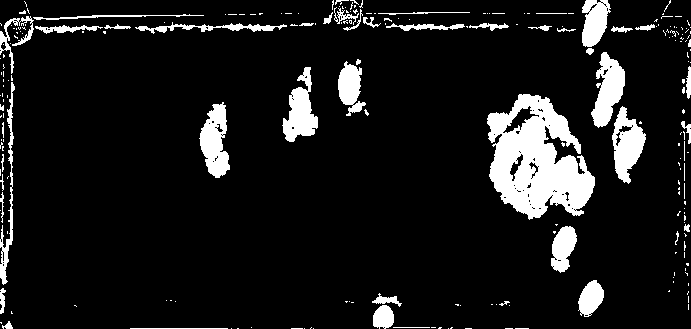

#+CAPTION: The circles that remain after the cushion and ball footprint checks.
#+ATTR_ORG: :width 600
#+ATTR_LATEX: :placement [H] :width 0.9\textwidth
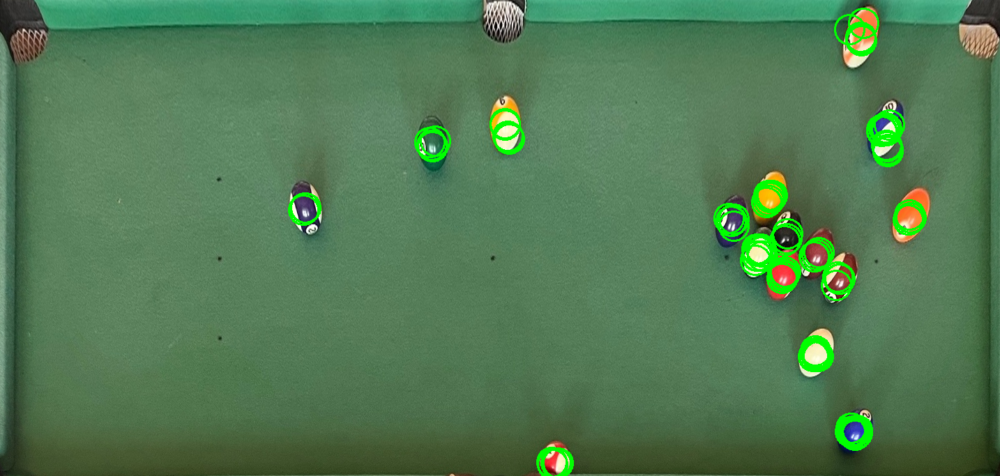

After that, I then refine the circles given to me by Hough with RANSAC, which helps adjust the circle positions for noise and makes the important centre point location more accurate.

#+CAPTION: The selected circles before (red) and after (green) RANSAC refinement.
#+ATTR_ORG: :width 600
#+ATTR_LATEX: :placement [H] :width 0.9\textwidth
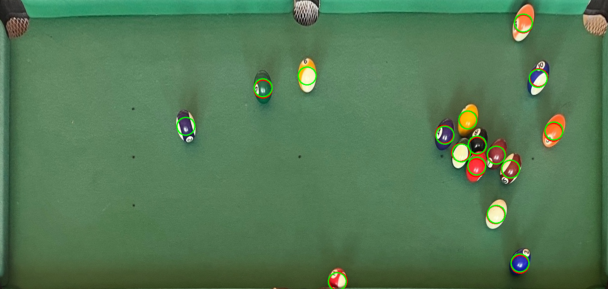

After running that, I had enough data to calculate the centre of the balls accurately, hence locating them.

Next, is the ball identification steps. In order to figure out which is which, I start by grabbing a HSV histogram, for which I have a separate one for each ball. Using the previous section's algorithms, I grabbed this for each ball and then using the Bhattacharyya distance, figure out how far a given ball sourced from the picture is to the ball in the reference image. Once I have this distance figure, I then rank them and greedily assign the closest match for each ball towards its histogram.

#+CAPTION: Hue and saturation histograms of the 16 reference balls, labelled by ball number.
#+ATTR_ORG: :width 300
#+ATTR_LATEX: :placement [H] :width 0.4\textwidth
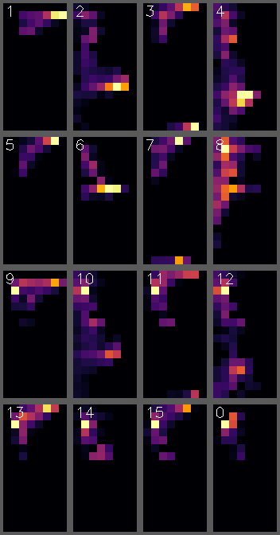

#+CAPTION: The final detected balls with their identified numbers.
#+ATTR_ORG: :width 600
#+ATTR_LATEX: :placement [H] :width 0.9\textwidth
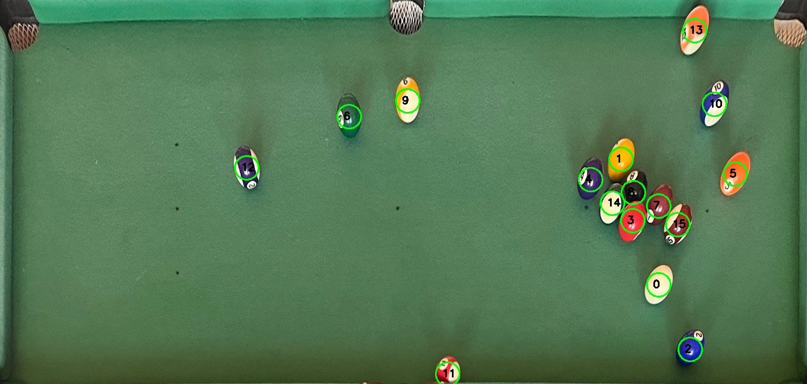

The parameters used at each stage are listed in [[parameters-table][the parameters table]].

#+NAME: parameters-table
#+CAPTION: Parameters used at each stage of the pipeline.
| Stage                  | Parameter                | Value                                         |
|------------------------+--------------------------+-----------------------------------------------|
| Perspective correction | Output size              | 1434 x 683 px                                 |
|                        | Interpolation            | Bicubic                                       |
| Median blur            | Kernel                   | 5 x 5                                         |
| Cloth histogram        | Bins (hue x saturation)  | 16 x 16                                       |
|                        | Ball exclusion radius    | 64 px                                         |
|                        | Smoothing                | 3 x 3 Gaussian                                |
| Segmentation           | Opening kernel           | 5 x 5 ellipse                                 |
| Canny edges            | Pre-blur                 | 5 x 5 Gaussian                                |
|                        | Upper threshold          | Larger of Otsu level and 6 x estimated noise  |
|                        | Lower threshold          | Half the upper threshold                      |
| Hough circles          | Strip height             | 43 px                                         |
|                        | Radius range             | Expected radius, widened by 20%               |
|                        | Minimum support          | 1/3 of the circumference                      |
| Ball filtering         | Cushion margin           | 10 px                                         |
|                        | Footprint size           | Median ball size from the reference photo     |
|                        | Minimum ball pixels      | 50% of the footprint                          |
| RANSAC                 | Iterations               | About 570                                     |
|                        | Sample size              | 3 points                                      |
|                        | Inlier tolerance         | 1.5 px                                        |
|                        | Radius tolerance         | 20%                                           |
|                        | Minimum support          | 1/3 of the circumference                      |
| Identification         | Bins (hue x sat x value) | 16 x 8 x 8                                    |
|                        | Pre-blur                 | 5 x 5 median                                  |

* TODO Results and analysis (roughly 50%).

** TODO You must present results for the set of images.

** TODO You must extensively illustrate both successes and failures (and provide an in-depth analysis of why failures have occurred).

** TODO You must provide performance metrics including a full explanation of how they are computed.

** TODO You must analyse the performance explaining what the results achieved mean.

** TODO You must also analyse your approach in terms of robustness (in other circumstances as well as those tested), appropriateness, etc.  Make suggestions for how you could improve the robustness of the solution.

* Figure generation :noexport:

Run the block below with =C-c C-c= to rebuild every figure above from the real pipeline.

#+NAME: generate-figures
#+begin_src sh :results output silent :exports none
ninja -C build stages && ./build/stages
#+end_src
