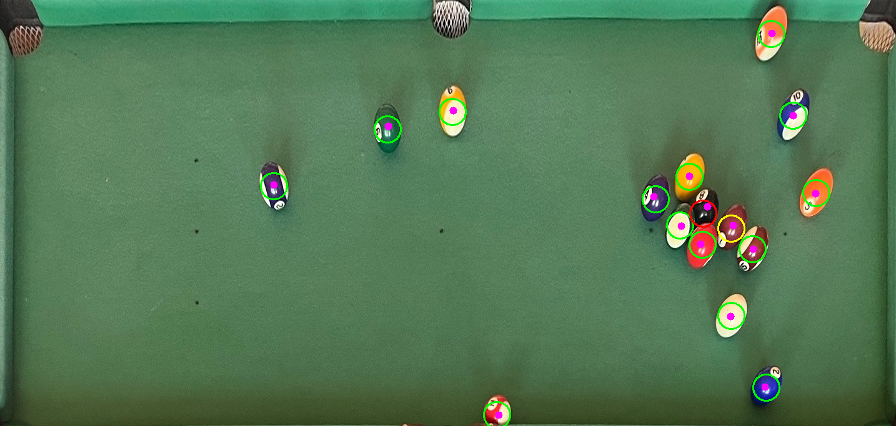
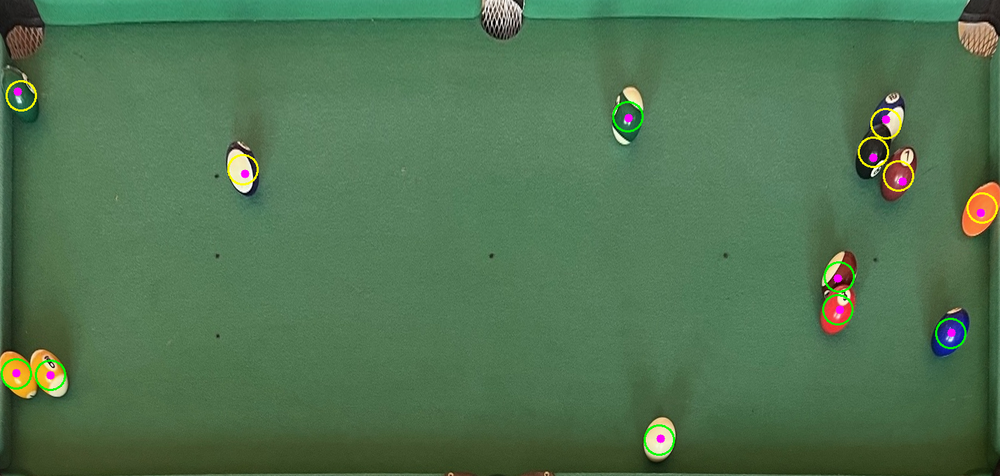
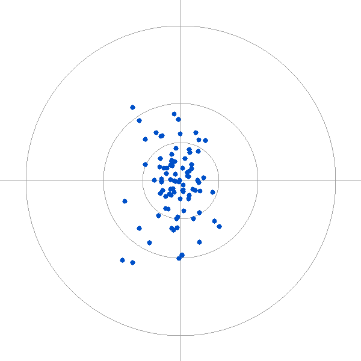

:PROPERTIES:
:ID:       report-outline
:END:
#+title: Computer Vision Report
#+author: Luke Bailey
#+OPTIONS: toc:nil date:nil
#+LATEX_CLASS_OPTIONS: [12pt,a4paper]
#+LATEX_HEADER: \usepackage{float}
#+LATEX_HEADER: \usepackage[margin=2.54cm]{geometry}
#+LATEX_HEADER: \usepackage{newtxtext}
#+LATEX_HEADER: \usepackage[compact]{titlesec}
#+LATEX_HEADER: \titlespacing*{\section}{0pt}{1.2ex plus .3ex}{0.6ex}
#+LATEX_HEADER: \titlespacing*{\subsection}{0pt}{1ex plus .2ex}{0.4ex}
#+LATEX_HEADER: \titlespacing*{\subsubsection}{0pt}{0.8ex plus .2ex}{0.3ex}
#+LATEX_HEADER: \usepackage[font=small,labelfont=bf,skip=3pt]{caption}
#+LATEX_HEADER: \setlength{\intextsep}{6pt plus 2pt minus 2pt}
#+LATEX_HEADER: \setlength{\floatsep}{6pt plus 2pt minus 2pt}
#+LATEX_HEADER: \setlength{\textfloatsep}{8pt plus 2pt minus 2pt}
#+LATEX_HEADER: \usepackage{enumitem}
#+LATEX_HEADER: \setlist{nosep}
#+LATEX_HEADER: \usepackage{titling}
#+LATEX_HEADER: \setlength{\droptitle}{-4em}
#+LATEX_HEADER: \pretitle{\begin{center}\Large\bfseries}\posttitle{\par\end{center}\vspace{-1.5em}}
#+LATEX_HEADER: \preauthor{\begin{center}\large}\postauthor{\par\end{center}\vspace{-1em}}
#+LATEX_HEADER: \predate{}\postdate{}
#+LATEX_HEADER: \makeatletter\setlength{\@fptop}{0pt}\setlength{\@fpsep}{10pt plus 4pt}\makeatother
#+LATEX_HEADER: \newenvironment{figurerow}{\begin{figure}[!htbp]}{\hspace*{\fill}\end{figure}}
#+LATEX_HEADER: \newenvironment{panel}[1]{\hspace*{\fill}\begin{minipage}[t]{#1\textwidth}}{\end{minipage}}

Below is my report on the methods I applied during image analysis on a pool ball table where the pool balls appeared in a variety of different positions. My goals were twofold:

- Find the balls: I had to locate the position of each ball on the table and return their position as coordinates

- Identify the balls: After finding the balls, I then had to identify each ball as its assigned number (or the white ball).

* Theory

Here, I will only describe the final algorithm I landed on.

** Stage 1: Locating the balls

*** Perspective correction

First of all, I noticed that the pool table appears at a slight angle from the camera and decided it would probably be in my best interests to do a perspective transform in order to get a more head on view. In this step I also crop part of the background just in case anything appears there that could interfere. To do this I used the table corners that were provided as the corner points.

#+begin_figurerow
#+ATTR_LATEX: :options {0.61}
#+begin_panel
#+CAPTION: The original photo, with the table outline used for the perspective correction.
#+ATTR_ORG: :width 600
#+ATTR_LATEX: :float nil :width \linewidth
[[file:figures/01-photo.png]]
#+end_panel
#+ATTR_LATEX: :options {0.33}
#+begin_panel
#+CAPTION: The table after perspective correction.
#+ATTR_ORG: :width 600
#+ATTR_LATEX: :float nil :width \linewidth
[[file:figures/02-perspective.png]]
#+end_panel
#+end_figurerow

*** Noise reduction

Next, since the table cloth is not one solid colour, but rather a textured object, I decided to denoise it a bit by applying a median blur to make it easier to separate the balls from the pool table cloth later on.

*** Cloth segmentation

I then produce a hue and saturation histogram for the cloth from the reference photo, as the lighting across the table isn't uniform and sampling hue and saturation means I can easily model the cloth first without interference from things like that.

#+begin_figurerow
#+ATTR_LATEX: :options {0.63}
#+begin_panel
#+CAPTION: The table after median blurring.
#+ATTR_ORG: :width 600
#+ATTR_LATEX: :float nil :width \linewidth
[[file:figures/03-smoothed.png]]
#+end_panel
#+ATTR_LATEX: :options {0.31}
#+begin_panel
#+CAPTION: The cloth's hue and saturation histogram: hue runs down, saturation runs across, and brighter means more common.
#+ATTR_ORG: :width 300
#+ATTR_LATEX: :float nil :width \linewidth
[[file:figures/04-cloth-histogram.png]]
#+end_panel
#+end_figurerow

After that, I then segment the non cloth object by back-projecting that histogram, giving me a greyscale image where the cloth is bright and the balls are dark. Once I have that, I can then run Otsu thresholding in order to clearly separate those into a binary "not cloth" mask. Once I have that, I then do a morphological open in order to remove any small flecks/leftover artifacts of noise and ensure that what I end up with is actually mainly just balls.

#+begin_figurerow
#+ATTR_LATEX: :options {0.47}
#+begin_panel
#+CAPTION: Back-projection of the cloth histogram: the cloth is bright and the balls are dark.
#+ATTR_ORG: :width 600
#+ATTR_LATEX: :float nil :width \linewidth
[[file:figures/05-likelihood.png]]
#+end_panel
#+ATTR_LATEX: :options {0.47}
#+begin_panel
#+CAPTION: The "not cloth" mask after Otsu thresholding and the morphological open.
#+ATTR_ORG: :width 600
#+ATTR_LATEX: :float nil :width \linewidth
[[file:figures/06-foreground.png]]
#+end_panel
#+end_figurerow

*** Colour contrast

After that I converted this into a relative LAB image by subtracting the cloth's average colour, in order to accurately measure how different two colours (the cloth vs the balls) look, allowing me to meaningfully measure distance.

#+CAPTION: Colour distance from the cloth in LAB.
#+ATTR_ORG: :width 600
#+ATTR_LATEX: :placement [!htbp] :width 0.6\textwidth
[[file:figures/07-contrast.png]]

*** Circle detection

With that, I then went and detected the photo edges with Canny, since it produces a number of thin, well located edges where the balls are. Using that edge map, I then ran a Hough transform in order to get approximate circle centers and radii for each ball. This also handles touching balls for me too. Both of these are run on the original image with no perspective transform since the balls will not appear as circles otherwise. I ran Hough in strips rather than all in one go as balls closer to the camera look bigger.

#+CAPTION: Canny edges, in the original photo's perspective.
#+ATTR_ORG: :width 600
#+ATTR_LATEX: :placement [!htbp] :width 0.9\textwidth
[[file:figures/08-edges.png]]

#+CAPTION: Candidate circles found by the Hough transform.
#+ATTR_ORG: :width 600
#+ATTR_LATEX: :placement [!htbp] :width 0.9\textwidth
[[file:figures/09-hough.png]]

*** Candidate filtering

Once I have the data from Hough, I then attempt to reject circles that aren't the balls (i.e. the cushions where balls go to score) by seeing if it lies too close to the table edge. I then also reduce it to a ball sized footprint by masking it with a ball image taken from the reference in order to filter things like shadows or the rest of the cushions. Each remaining candidate is scored by how much of its outline lies on a detected edge. Before this, the ball mask removes the cushions, I mark the pixels connecting to the image border, compare them to the same pixels in the reference photo and drop those within 3 times the spread of the cloth colour.

#+begin_figurerow
#+ATTR_LATEX: :options {0.47}
#+begin_panel
#+CAPTION: The ball mask: the "not cloth" pixels with the cushion removed.
#+ATTR_ORG: :width 600
#+ATTR_LATEX: :float nil :width \linewidth
[[file:figures/10-ball-mask.png]]
#+end_panel
#+ATTR_LATEX: :options {0.47}
#+begin_panel
#+CAPTION: The circles that remain after the cushion and ball footprint checks.
#+ATTR_ORG: :width 600
#+ATTR_LATEX: :float nil :width \linewidth
[[file:figures/11-kept.png]]
#+end_panel
#+end_figurerow

*** Centre refinement

After that, I then refine the circles given to me by Hough with RANSAC, which helps adjust the circle positions for noise and makes the important centre point location more accurate.

#+CAPTION: The selected circles before (red) and after (green) RANSAC refinement.
#+ATTR_ORG: :width 600
#+ATTR_LATEX: :placement [!htbp] :width 0.6\textwidth
[[file:figures/12-refined.png]]

After running that, I had enough data to calculate the centre of the balls accurately, hence locating them.

** Stage 2: Identifying the balls

Next, is the ball identification steps. In order to figure out which is which, I start by grabbing a HSV histogram, for which I have a separate one for each ball (from the provided spreadsheet). Using the previous section's algorithms, I grabbed this for each ball and then using the Bhattacharyya distance, figure out how far a given ball sourced from the picture is to the ball in the reference image. Once I have this distance figure, I then rank them and greedily assign the closest match for each ball towards its histogram.

#+begin_figurerow
#+ATTR_LATEX: :options {0.24}
#+begin_panel
#+CAPTION: Hue and saturation histograms of the 16 reference balls, labelled by ball number.
#+ATTR_ORG: :width 300
#+ATTR_LATEX: :float nil :width \linewidth
[[file:figures/13-ball-histograms.png]]
#+end_panel
#+ATTR_LATEX: :options {0.70}
#+begin_panel
#+CAPTION: The final detected balls with their identified numbers.
#+ATTR_ORG: :width 600
#+ATTR_LATEX: :float nil :width \linewidth
[[file:figures/14-identified.png]]
#+end_panel
#+end_figurerow

** Parameters

The parameters used at each stage are listed in [[parameters-table][the parameters table]].

#+NAME: parameters-table
#+CAPTION: Parameters used at each stage of the pipeline.
| Stage                  | Parameter                | Value                                        |
|------------------------+--------------------------+----------------------------------------------|
| Perspective correction | Output size              | 1434 x 683 px                                |
|                        | Interpolation            | Bicubic                                      |
| Median blur            | Kernel                   | 5 x 5                                        |
| Cloth histogram        | Bins (hue x saturation)  | 16 x 16                                      |
|                        | Ball exclusion radius    | 64 px                                        |
|                        | Smoothing                | 3 x 3 Gaussian                               |
| Segmentation           | Opening kernel           | 5 x 5 ellipse                                |
| Canny edges            | Pre-blur                 | 5 x 5 Gaussian                               |
|                        | Upper threshold          | Larger of Otsu level and 6 x estimated noise |
|                        | Lower threshold          | Half the upper threshold                     |
| Hough circles          | Strip height             | 43 px                                        |
|                        | Radius range             | Expected radius, widened by 20%              |
|                        | Minimum support          | 1/3 of the circumference                     |
| Ball filtering         | Cushion margin           | 10 px                                        |
|                        | Footprint size           | Median ball size from the reference photo    |
|                        | Minimum ball pixels      | 50% of the footprint                         |
| Cushion removal        | Border components        | Connected to the image border                 |
|                        | Colour tolerance         | 3 x cloth colour spread                       |
| RANSAC                 | Iterations               | About 570                                    |
|                        | Sample size              | 3 points                                     |
|                        | Inlier tolerance         | 1.5 px                                       |
|                        | Radius tolerance         | 20%                                          |
|                        | Minimum support          | 1/3 of the circumference                     |
| Identification         | Bins (hue x sat x value) | 16 x 8 x 8                                   |
|                        | Pre-blur                 | 5 x 5 median                                 |

* Results and Analysis

** Evaluation method

*** Metrics

The assignment brief made it clear to me how much I should focus on evaluation and the metrics I pick as one of the primary goals of this project right from the get go. As a result, before even writing a single line of code I started by first figuring out how I was going to evaluate this work.

The primary metrics I selected were all ones I recalled from prior lectures. I opted for:
- Precision (the fraction of detections that were real balls)
- Recall (the fraction of real balls that were found)
- F1 (the harmonic mean of precision and recall)
- Identification Accuracy (the fraction of correctly located balls that got identified with the right number)

*** Metric computation

To score a photo, I measured the distance between every detected center and every labelled center in the corrected table view. A detection and a label are counted as correct if they are closer than the match distance (25%, 50% or 100% of ball radius). I then sorted these pairs from closest to furthest and accepted them if it hasn't already been marked as detected.

*** Robustness testing

I was also aware that my submitted application code would likely be evaluated against more permutations of the pool table than I had access to based on the small sample amount provided in the assignment. Hence, in order to increase the generality of my code, I also decided to write an external wrapper harness around what I would submit in order to test my code against further augmented versions of the original test set, doing things like mirroring the original images, applying extra noise, playing with saturation values, and more in order to try and make my code resilient to unexpected changes.

*** Pipeline variants

After all of this, I could then plan what algorithm I would actually implement in my vision processing system. I decided to plan a couple feasible variants since truthfully I wasn't too sure which would perform the best without measuring and evaluating them each in turn. This included different ways to locate the balls as an alternative to where Hough currently stands in the pipelines or other ways of refining the found circles as alternatives to RANSAC.

** Results

The results for each of the six photos are in [[results-table][the results table]]. Each photo is scored at three match distances: 25%, 50% and 100% of a ball radius (a radius is about 21.5 px in the corrected view, so the strictest distance is roughly 5 px). Precision, recall and F1 are identical in every row, so they are shown as one column. Identification accuracy was the same value throughout.

#+NAME: results-table
#+CAPTION: Detection and identification results per photo at each match distance.
| Photo   | Match distance | Found | Missed | False | Precision / Recall / F1 | Identification |
|---------+----------------+-------+--------+-------+-------------------------+----------------|
| Table1  | 25% radius     | 9/16  |      7 |     7 |                   0.562 |          1.000 |
|         | 50% radius     | 15/16 |      1 |     1 |                   0.938 |          1.000 |
|         | 100% radius    | 16/16 |      0 |     0 |                   1.000 |          1.000 |
| Table2  | 25% radius     | 14/16 |      2 |     2 |                   0.875 |          1.000 |
|         | 50% radius     | 15/16 |      1 |     1 |                   0.938 |          1.000 |
|         | 100% radius    | 16/16 |      0 |     0 |                   1.000 |          1.000 |
| Table3  | 25% radius     | 13/16 |      3 |     3 |                   0.812 |          1.000 |
|         | 50% radius     | 16/16 |      0 |     0 |                   1.000 |          1.000 |
|         | 100% radius    | 16/16 |      0 |     0 |                   1.000 |          1.000 |
| Table4  | 25% radius     | 10/15 |      5 |     5 |                   0.667 |          1.000 |
|         | 50% radius     | 14/15 |      1 |     1 |                   0.933 |          1.000 |
|         | 100% radius    | 15/15 |      0 |     0 |                   1.000 |          1.000 |
| Table5  | 25% radius     | 8/14  |      6 |     6 |                   0.571 |          1.000 |
|         | 50% radius     | 13/14 |      1 |     1 |                   0.929 |          1.000 |
|         | 100% radius    | 14/14 |      0 |     0 |                   1.000 |          1.000 |
| Table6  | 25% radius     | 7/13  |      6 |     6 |                   0.538 |          1.000 |
|         | 50% radius     | 13/13 |      0 |     0 |                   1.000 |          1.000 |
|         | 100% radius    | 13/13 |      0 |     0 |                   1.000 |          1.000 |
|---------+----------------+-------+--------+-------+-------------------------+----------------|
| *Total* | 25% radius     | 61/90 |     29 |    29 |                   0.678 |          1.000 |
|         | 50% radius     | 86/90 |      4 |     4 |                   0.956 |          1.000 |
|         | 100% radius    | 90/90 |      0 |     0 |                   1.000 |          1.000 |

** Successes and failures

*** Best case

#+begin_figurerow
#+ATTR_LATEX: :options {0.47}
#+begin_panel
#+CAPTION: Table2, the best photo at the strictest distance (0.875). Each circle is a detection: green is within 25% of a ball radius of its label, yellow within 50%, red within 100%.
#+ATTR_ORG: :width 600
#+ATTR_LATEX: :float nil :width \linewidth

#+end_panel
#+ATTR_LATEX: :options {0.47}
#+begin_panel
#+CAPTION: Table6, the worst photo at the strictest distance (0.538), with the same colour key.
#+ATTR_ORG: :width 600
#+ATTR_LATEX: :float nil :width \linewidth

#+end_panel
#+end_figurerow

Table 2 happened to get the best strictest distance as its Hough circles were almost all calculated within 25% of radius properly.

*** Worst case

Table 6 got the worst strictest distance, but every ball was still found and identified correctly within 50% of a ball radius. The six balls that did miss all miss at 25%, showing the limited accuracy.

*** Localisation error

#+CAPTION: Detected minus labelled centre for all 90 matched balls. The rings are 25%, 50% and 100% of a ball radius.
#+ATTR_ORG: :width 300
#+ATTR_LATEX: :placement [!htbp] :width 0.4\textwidth

This plot shows how close each ball was when found by the detection system vs its label. From this we can conclude there's no clear bias since they don't all shift in one direction, we have a taller spread implying that the likely the perspective transform slightly disproportionately affected the verticals when opposed to the horizontals, and that the majority of the balls were able to be accurately detected, even inside of 25% of a ball radius.

** Discussion

I would hope that this evaluation shows that detection is complete at a practical tolerance - all 90 balls were found within at least one ball radius away from the center, and the majority were found in less than that.

Precision, recall and F1 were all equal here because the system only returns on detection per ball.

I also achieved an identification score of 1.000 here, implying that all balls were able to be identified correctly. This is a little optimistic perhaps as it was only evaluated on the small sample of input images we were given.

** Robustness and improvements

In order to check the robustness of my system in the face of varying conditions, I applied a number of transformations to the input image set in order to try and simulate a wider range of conditions without having access to more input images. This included modifying:

- Gamma
- Colour cast
- Reduced saturation
- Lighting gradient
- Sensor noise
- Defocus blur
- Resolution loss
- Corner offset
- Cast shadow
- Glare

After running through all of these, finding the balls seemed to hold up quite well, however identifying which ball was which was what seemed to fail. This is likely because I applied a number of transformations which effect the histograms used to measure which ball is which, which is a weakness of my system.

* Acknowledgements and use of generative AI

** Generative AI

I will admit, I made plentiful use of generative AI during this assignment. Specifically, the majority
of my use went directly to Claude Code (Anthropic). It helped me to write and refactor the code to my liking, along with allowing me to test the variants of my algorithms I mentioned earlier in parallel. I wrote much of the skeleton myself, then I proposed to it a set of pipelines to test and evaluate autonomously, and then helped me combine the best bits of each into the final algorithm that I ended up with. It also helped me create the testing setup for running my code on the transformed versions of the images during my robustness evaluations.

Additionally, it has helped provide feedback and proof read this report. However, that has been limited to reading only as I find AI generated prose unpleasant to read and generally distasteful to hand to someone else with the expectation they engage with it.

** Other information sources

I also consulted the [[https://docs.opencv.org/5.0/][OpenCV documentation]] both online and in my editor frequently, alongside copies of the provided lecture materials in order to get a general sense of the direction I wanted to take things.

* Figure generation :noexport:

Run the block below with =C-c C-c= to rebuild every figure above from the real pipeline.

#+NAME: generate-figures
#+begin_src sh :results output silent :exports none
ninja -C build stages && ./build/stages
#+end_src
